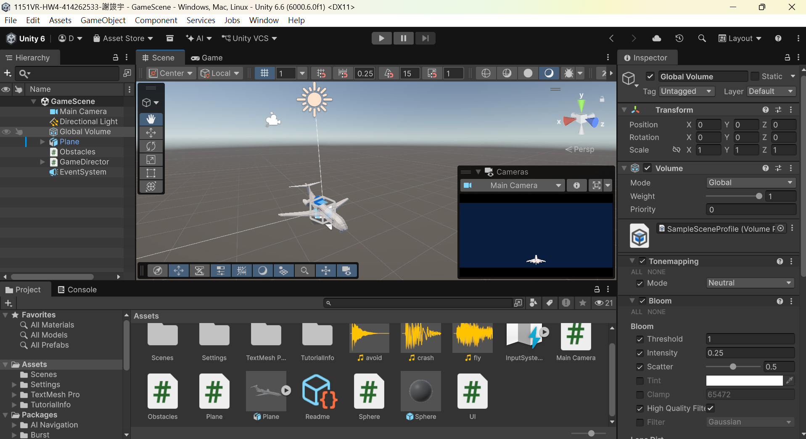

https://github.com/DanielHsieh2533/1151VR-HW4-414262533-HCY

https://youtube.com/shorts/CpL7M8JdRR4?si=dcDFOn3B0j38liqP

實作飛行器與障礙物碰撞，並使用導演物件控制UI，並加入飛行音效、閃過音效，及撞到音效。遊戲玩法是飛行器會跟隨滑鼠位置，手機上則是觸控位置，並將碰撞次數寫在右上角。
